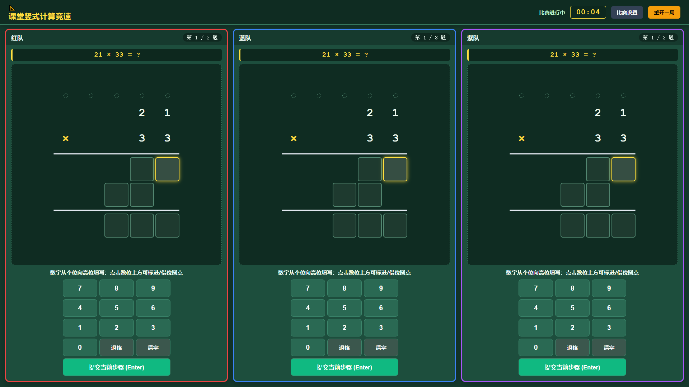
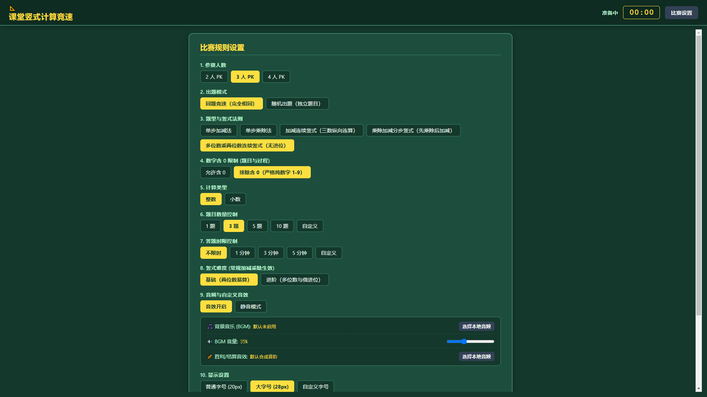

# 📐 课堂竖式计算竞速小游戏

一款面向小学数学课堂的多人同屏计算竞速游戏。通过数字键盘填写竖式计算过程，让学生在比赛中练习计算、理解数位对齐、进位与借位等数学知识。

## 🎮 项目介绍

**课堂竖式计算竞速小游戏** 是一个基于 HTML、CSS 和 JavaScript 开发的网页小游戏，无需安装软件，使用浏览器即可运行。

游戏采用深绿色课堂竞赛界面，支持多名学生同时参与计算比赛，适用于小学数学课堂、计算能力训练和趣味数学活动。

## ✨ 主要功能

- **多人同屏竞赛**：支持 2 人、3 人或 4 人同时比赛。
- **两种出题模式**：支持同题竞速和随机出题。
- **多种计算题型**：支持加减法、乘除法、连续加减竖式、分步混合运算和多位数乘两位数竖式。
- **整数与小数练习**：可选择整数或小数计算。
- **灵活的比赛设置**：可自定义题目数量、答题时限和部分计算难度。
- **独立数字键盘**：每位选手拥有独立的数字输入区域。
- **竖式过程练习**：支持逐位填写计算结果，并可标记进位与借位。
- **比赛结果统计**：完成比赛后展示选手排名及相关成绩。
- **音效与背景音乐**：支持开启或关闭音效、加载本地背景音乐，以及自定义胜利音效。
- **个性化显示**：支持调整字号、字重和字体风格。

## 🚀 如何运行

### 方法一：直接运行

1. 下载本项目中的 HTML 文件。
2. 双击打开 HTML 文件，或将文件拖入 Chrome、Edge 等现代浏览器。
3. 在比赛设置页面选择参赛人数、题型和比赛规则。
4. 点击「开始比赛」，即可开始游戏。

无需安装 Node.js、Python 或其他开发环境。

### 方法二：在线体验

本项目支持通过 GitHub Pages 部署为在线网页。

部署完成后，可以直接通过网页链接访问游戏，无需下载文件。

在线体验地址：待部署后补充。

## 🕹️ 游戏玩法

1. 设置参赛人数、出题模式和计算题型。
2. 根据屏幕上的竖式，使用各自的数字键盘填写答案。
3. 按照竖式计算顺序完成当前步骤，并提交答案。
4. 完成所有题目后，系统根据比赛成绩展示排名。

## 🛠️ 技术栈

- HTML5
- CSS3
- JavaScript
- Web Audio API

项目采用原生前端技术实现，无需第三方框架或外部依赖。

## 📂 项目结构

```text
math-column-racing/
├── index.html       # 游戏主程序
├── README.md        # 项目说明文档
└── LICENSE          # 开源许可证（可选）
```
## 🎮 游戏预览



### 设置界面




## 📌 项目状态

当前版本：2.0

项目仍可继续完善，欢迎提交建议、反馈问题或参与改进。

## 🤝 反馈与贡献

如果你在使用过程中发现问题，或有新的功能建议，欢迎通过 GitHub Issues 反馈。

如果这个小游戏能让更多学生爱上数学计算，那它就有了存在的意义。欢迎体验与交流！
